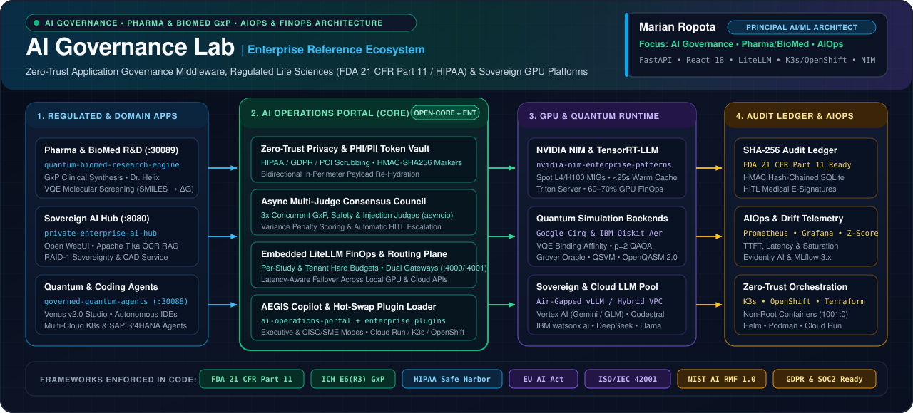

  

# AI Governance Lab — Organization Profile Repository (`.github`)

**AI Governance Lab** is an executive architecture and engineering lab dedicated to building governed, compliant, and scalable Enterprise AI systems across Pharma/BioMed (GxP / FDA 21 CFR Part 11), AIOps/FinOps control planes, and sovereign hybrid-cloud GPU environments.

> 📌 **Public Organization Profile:** Rendered from [`profile/README.md`](profile/README.md) at **[https://github.com/AI-Governance-Lab](https://github.com/AI-Governance-Lab)**.

## Architectural Scope

- **AI Operations, FinOps & Governance Middleware:** Self-hosted OpenAI-compatible governance appliance (`ai-operations-portal` Open-Core + private `ai-operations-portal-enterprise` plugins) delivering `HMAC-SHA256` PII/HIPAA token vaulting, async 3-judge consensus, native Prometheus `/metrics` AIOps, rolling z-score drift alerts, and SHA-256/HMAC audit ledgers.
- **Pharma R&D, GxP Clinical Trials & FDA 21 CFR Part 11:** Deterministic HIPAA Safe Harbor PHI scrubbing, 3x concurrent GxP multi-judge consensus (`SUSAR` → HITL escalation), hybrid quantum VQE molecular screening (`SMILES → ΔG kcal/mol`), study grant FinOps, and Part 11 electronic signatures (`quantum-biomed-research-engine`).
- **Sovereign AI Hubs & Dual LiteLLM Gateways:** Self-hosted Open WebUI (`:8080`), Main (`:4000`) & Agentic (`:4001`) LiteLLM proxies, RAID-1 local sovereignty, Apache Tika OCR RAG, and FastAPI CAD reconciliation (`private-enterprise-ai-hub`).
- **High-Performance GPU Inference AIOps:** NVIDIA NIM, TensorRT-LLM, and Triton across Terraform GCP Spot L4 MIGs (`<25s` warm engine cache) and K3s/Helm (`nvidia-nim-enterprise-patterns`).
- **Cross-Model LLM-as-Judge & Quantum Orchestration:** Google Cirq & IBM Qiskit Aer circuit synthesis (`VQE`, `QAOA`, `Grover`, `QSVM`) audited by an independent cross-vendor Memory-Aware Judge Observatory (`governed-quantum-agents`).
- **Multi-Cloud MLOps, Kubernetes & SAP S/4HANA:** EU AI Act drift monitoring with Evidently AI (`k8s-evidently-demo`), SAP S/4HANA provisioning on Red Hat OpenShift & IBM PowerVS (`s4hana-ai-agent-openshift`), guarded AWS EKS/Rancher Terraform agents (`k8s-ai-agent-multicloud-rag-iac`), and Vertex AI Kubeflow/ADK pipelines.

## Repository Portfolio

| Repository | Architectural Tier | Domain & Governance Scope | Availability |
| :--- | :--- | :--- | :--- |
| **`ai-operations-portal`** | 🌟 **2026 Flagship #1** | Self-Hosted AI Governance, FinOps, Token Vault, Async Multi-Judge, Prometheus AIOps & SHA-256 Audit Appliance | 🌐 Source-Available `v1.0.0` *(+ 🔒 Enterprise Suite)* |
| **`quantum-biomed-research-engine`** | 🌟 **2026 Flagship #2** | Pharma R&D, GxP Clinical Synthesis, 3x Multi-Judge, Quantum VQE Drug Screener & FDA 21 CFR Part 11 Ledger | 🌐 Public |
| **`private-enterprise-ai-hub`** | 🌟 **2026 Flagship #3** | Sovereign Enterprise AI Hub, Dual LiteLLM Gateways (`:4000` & `:4001`), Tika OCR & CAD Microservice | 🌐 Public |
| **`nvidia-nim-enterprise-patterns`** | 🌟 **2026 Flagship #4** | NVIDIA NIM, TensorRT-LLM & Triton GPU Inference Patterns (Terraform GCP Spot MIGs & K3s/Helm) | 🌐 Public |
| **`governed-quantum-agents`** | 🌟 **2026 Flagship #5** | Venus v2.0: Cross-Model LLM-as-a-Judge & Dual-SDK Quantum Studio (Cirq + Qiskit + K3s Helm) | 🌐 Public |
| `k8s-evidently-demo` | 🏛️ Foundational Lab | Continuous AI Drift & EU AI Act Compliance Monitoring on Kubernetes (Evidently, Prometheus, Grafana) | 🌐 Public |
| `s4hana-ai-agent-openshift` | 🏛️ Foundational Lab | Zero-Touch SAP S/4HANA Provisioning Agent (IBM Red Hat OpenShift ROKS, watsonx.ai, PowerVS) | 🌐 Public |
| `k8s-ai-agent-multicloud-rag-iac` | 🏛️ Foundational Lab | Multi-Cloud Qdrant RAG + Guarded Terraform Runner Agent (AWS EKS & Rancher) | 🌐 Public |
| `vertex-ai-pipeline-demo` | 🏛️ Foundational Lab | Vertex AI Pipelines (Kubeflow v2) MLOps Lineage & Orchestration | 🌐 Public |
| `vertex-ai-agentbuilder-demo` | 🏛️ Foundational Lab | Google Vertex AI Agent Builder, Reasoning Engine & ADK Patterns | 🌐 Public |

<b>🗄️ Archived Early Kubernetes &amp; MLOps Sandboxes (5 Completed Reference Labs — Click to Expand)</b>

 

| Repository | Original Scope | Superseded By |
| :--- | :--- | :--- |
| `k8s-mlfow-demo` | Cluster MLflow 3.x Stack (PostgreSQL + MinIO) | `ai-operations-portal` |
| `k8s-mlflow-rancher-desktop` | Local K3s Developer MLflow 3.x Stack via Helm | 2026 K3s Helm Flagships |
| `k8s-ai-agents-demo` | Reference Kubernetes AI Agent Services (Qdrant, FastAPI, MLflow) | `ai-operations-portal` & `quantum-biomed-research-engine` |
| `k8s-ollama-fastapi-demo` | Air-Gapped Local LLM Serving with Ollama & FastAPI on K8s | `nvidia-nim-enterprise-patterns` & `private-enterprise-ai-hub` |
| `vertex-ai-cloudrun-demo` | Serverless Vertex AI Embeddings & Gemini Microservices on Cloud Run | `ai-operations-portal` |

## License

Foundational reference repositories default to **Apache License 2.0**; **`ai-operations-portal`** is **Source-Available (All Rights Reserved — Portfolio & Evaluation Only)**, and **`ai-operations-portal-enterprise`** is private/proprietary (see individual repository `LICENSE` files).

---

## Founder & Principal Architect

**Marian Ropota** — *Principal AI/ML, AI Governance & AIOps Architect | Regulated Pharma/BioMed (GxP), Hybrid Cloud & Sovereign AI Platforms*  
🔗 [LinkedIn](https://www.linkedin.com/in/marian-rop) • 🏅 [Credly Certifications](https://www.credly.com/users/marian-ropota/badges/credly) • 🐙 [AI Governance Lab](https://github.com/AI-Governance-Lab)