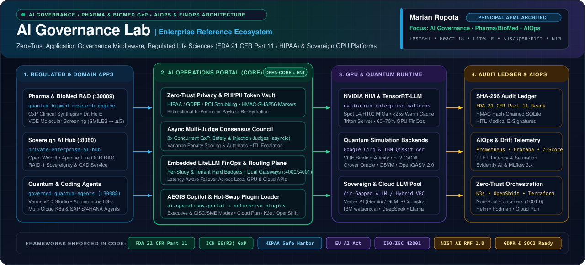
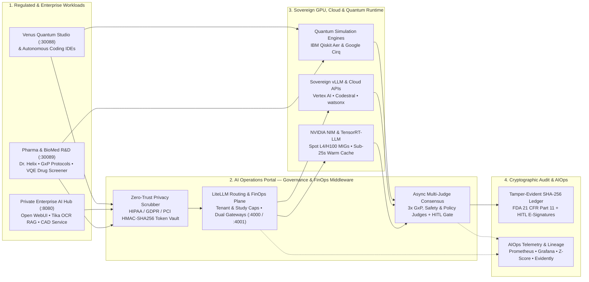

  

<h1 align="center">AI Governance Lab 🏛️🧬🛡️</h1>

  <strong>Principal AI/ML, AI Governance &amp; AIOps Architecture — Regulated Pharma &amp; BioMed (GxP / FDA 21 CFR Part 11), Zero-Trust AI Operations Middleware &amp; Sovereign GPU Platforms</strong> 
  Founded &amp; Engineered by <a href="https://www.linkedin.com/in/marian-rop"><strong>Marian Ropota</strong></a> · <em>Hands-On Principal AI/ML, AI Governance &amp; Cloud Platform Architect</em>

  
  
  
  
  
  

**AI Governance Lab** is an executive reference ecosystem demonstrating **production-grade AI Governance, Regulated Pharmaceutical/BioMed R&D, and Enterprise AIOps/FinOps engineering**. Every architectural blueprint is backed by **executable full-stack code** (`Python`, `FastAPI`, `React 18`, `Asyncio`, `Pydantic v2`, `HMAC/SHA-256 Audit Ledgers`) and **hardened multi-cloud orchestration** (`Kubernetes/K3s`, `Red Hat OpenShift`, `Helm`, `Terraform`, `Podman/Docker`, `Google Cloud Run`).

---

## 🎯 Executive Portfolio — The 5 Flagship 2026 Architecture Pillars

Designed for **Chief AI Officers, VPs of Pharma/BioMed R&D, CISOs, Heads of Platform Engineering, and Executive Recruiters**, the organization centers on **five interconnected 2026 flagship platforms**, supported below by a proven multi-cloud MLOps, Kubernetes, and SAP S/4HANA track record:

| # | Architectural Pillar | Repository | Core Capabilities & Governance Controls | Architect Focus |
| :-: | :--- | :--- | :--- | :--- |
| **1** | **AI Operations, FinOps & Governance Command Center** | **[`ai-operations-portal`](https://github.com/AI-Governance-Lab/ai-operations-portal)** *(+ Private Enterprise Suite)* | OpenAI-compatible governance middleware, **HMAC-SHA256 PII/HIPAA token vault**, async **3-judge quorum**, **Prometheus TTFT/saturation AIOps**, SHA-256 ledger & **AEGIS** CISO copilot | *Principal AI Governance & AIOps Architect* |
| **2** | **Pharma R&D, GxP Clinical Trials & FDA 21 CFR Part 11** | **[`quantum-biomed-research-engine`](https://github.com/AI-Governance-Lab/quantum-biomed-research-engine)** | Deterministic **HIPAA PHI scrubber**, **3x concurrent GxP judges** (`SUSAR` → HITL review), **Quantum VQE drug screening (`SMILES → ΔG`)**, **Part 11 e-signatures** & study FinOps | *Principal Pharma / BioMed AI & GxP Architect* |
| **3** | **Sovereign Enterprise AI Hub & Dual LiteLLM Plane** | **[`private-enterprise-ai-hub`](https://github.com/AI-Governance-Lab/private-enterprise-ai-hub)** | **70–85% SaaS cost reduction**, isolated Main (`:4000`) & Agentic (`:4001`) **LiteLLM gateways**, **RAID-1 GDPR sovereignty**, Apache Tika OCR RAG & FastAPI CAD microservice | *Chief / Principal GenAI Platform Architect* |
| **4** | **GPU Inference AIOps & Hybrid Cloud IaC** | **[`nvidia-nim-enterprise-patterns`](https://github.com/AI-Governance-Lab/nvidia-nim-enterprise-patterns)** | **NVIDIA NIM, TensorRT-LLM & Triton** on K3s/Helm and Terraform GCP Spot L4 MIGs (**`<25s` warm engine cache**, **60–70% GPU FinOps savings**) | *Principal GPU & AI Infrastructure Architect* |
| **5** | **Cross-Model LLM-as-Judge & Quantum Discovery** | **[`governed-quantum-agents`](https://github.com/AI-Governance-Lab/governed-quantum-agents)** *(Venus v2.0)* | **Google Cirq & IBM Qiskit Aer** compiler (`VQE`, `QAOA`, `Grover`, `QSVM`) audited by an independent cross-vendor **Memory-Aware Judge Observatory** on K3s | *AI Governance & Quantum-AI Architect* |

---

## 🏛️ Unified 2026 Governance & AIOps Control Plane

---

## 🌟 Flagship 2026 Enterprise Systems (Deep-Dive)

### 1. 🛡️ [AI Operations Portal (`ai-operations-portal`)](https://github.com/AI-Governance-Lab/ai-operations-portal) — `🌐 Source-Available v1.0.0 (Evaluation Only) + 🔒 Enterprise Suite`
**100% Self-Hosted AI Governance, FinOps, Data Sovereignty & AIOps Command Center Engineered for Air-Gapped Perimeters, Kubernetes (K3s / Red Hat OpenShift) & Cloud Run.**
- **Zero-Trust Privacy Vault & Async Multi-Judge Quorum:** Intercepts OpenAI-compatible payloads (`POST /v1/chat/completions`) before upstream model dispatch. Tokenizes regulated spans (`HIPAA_MRN`, `PCI_CARD`, `IBAN`, `API_SECRET`, `CAD_DWG`) into reversible per-tenant `HMAC-SHA256` markers, evaluates completions via a concurrent 3-judge compliance council (injection, exfiltration, policy), and chains every verdict into an immutable **SHA-256 / HMAC SQLite audit ledger**.
- **Native AIOps Observability, Dynamic FinOps & AEGIS Copilot:** Exports real-time Prometheus `/metrics` (TTFT, latency histograms, token throughput, `psutil` saturation) paired with rolling z-score drift detection, turnkey Grafana NOC/SOC dashboards, dynamic LiteLLM budget circuit-breakers, and **AEGIS**—a dual-mode (*Executive* vs. *CISO/SME*) governance explainer.
- **Modular Source-Available Core + Hot-Swappable Enterprise Architecture:** Runs standalone for evaluation (`All Rights Reserved — Portfolio & Evaluation Only`, `edition: "open-core"`) with verified [`prtscr&logs/`](https://github.com/AI-Governance-Lab/ai-operations-portal/tree/main/prtscr%26logs) API/UI proofs, and dynamically upgrades at startup (`plugin_loader.py` / `entry_points`) when the private **`ai-operations-portal-enterprise`** suite is mounted (`EnterpriseVaultScrubber`, `EnterpriseMultiJudgeCouncil`, `PersistentSQLiteLedger`, `EnterpriseAnomalyPredictor`). Hardened non-root (`UID 1001:0`) container ready for OpenShift, K3s, Podman/Docker, and Cloud Run.  
*Stack: FastAPI, React 18, LiteLLM Proxy, Python Asyncio, Pydantic v2, HMAC-SHA256 SQLite WAL Ledger, Prometheus, Grafana, Docker/Podman, K3s / Red Hat OpenShift*

---

### 2. 🧬 [Quantum BioMed Research & GxP Governance Engine (`quantum-biomed-research-engine`)](https://github.com/AI-Governance-Lab/quantum-biomed-research-engine) — `🌐 Public • Live on K3s (:30089)`
**Regulated Pharmaceutical R&D, ICH E6(R3) GxP Clinical Trial Synthesis, 3x Pharmacovigilance Judge Consensus, Quantum VQE Drug Screening & FDA 21 CFR Part 11 Auditability.**
- **HIPAA Safe Harbor PHI Scrubber & 3x Concurrent GxP Judges:** Deterministic pre-inference redaction of patient identifiers (`PHIScrubber`), citation-anchored clinical protocol synthesis (`[CIT-P1]` / `[CIT-P2]`), and concurrent `asyncio.gather` evaluation (`ClinicalGroundednessJudge`, `PharmacovigilanceSafetyJudge`, `GxPComplianceJudge`) with variance-penalized consensus (`S = μ_w - λσ² ≥ 0.95`) and automatic escalation to `PENDING_HITL_MEDICAL_REVIEW` on **SUSAR** / Grade 4+ toxicities.
- **Hybrid Quantum-AI Molecular Screening (`SMILES → E₀ & ΔG kcal/mol`):** Encodes oncology and neurology ligands (`Sotorasib`, `Osimertinib`, `Verubecestat`) against target receptors (`KRAS-G12C`, `EGFR-T790M`, `BACE1`) into parameterized `RY/RZ + CNOT` quantum circuits to estimate VQE ground-state energies and binding affinities.
- **FDA 21 CFR Part 11 Ledger, Study Grant FinOps & "Dr. Helix" Workbench:** Enforces tamper-evident SHA-256 electronic records (`§11.10`), legally binding Medical Monitor HITL Electronic Signatures (`§11.50 / §11.70`), per-study USD grant caps (`HTTP 402` circuit-breaker), and a React 18 workbench with **Dr. Helix** multi-turn copilot and Helm PVC deployment.  
*Stack: FastAPI, Pydantic v2, React 18, FDA Part 11 SHA-256 SQLite Ledger, Quantum VQE (Qiskit & Statevector), LiteLLM, NVIDIA NIM, K3s/Kubernetes, Helm*

---

### 3. 🏢 [Private Enterprise AI Hub (`private-enterprise-ai-hub`)](https://github.com/AI-Governance-Lab/private-enterprise-ai-hub) — `🌐 Public • Production Stack`
**Sovereign Self-Hosted Enterprise GenAI Platform, Dual LiteLLM Gateways (`:4000` & `:4001`), Zero-CPU Cloud RAG & Domain Microservices.**
- **70%–85% SaaS Cost Reduction via Dual Isolated Gateways:** Separates human workspace traffic (**Main Hub Gateway `:4000`** powering **Open WebUI `:8080`** + cloud-offloaded RAG embeddings) from autonomous IDE/agent tool-calling (**Agentic Gateway `:4001`** serving Cline, Roo Code, and Aider with zero downtime).
- **100% Local Data Sovereignty (GDPR Ready):** Keeps sensitive clinical/financial PDFs, spreadsheets, CAD drawings (`.dwg`/`.dxf`), and SQLite state on local **RAID-1 storage**, paired with **Apache Tika OCR (`:9998`)**, an air-gapped **FastAPI CAD Reconciliation Microservice**, and `chmod 600` `.env` + `systemd` boot resilience.  
*Stack: LiteLLM, Open WebUI, FastAPI, Vertex AI (Gemini / GLM MaaS), Mistral Codestral, NVIDIA NIM, Apache Tika OCR, Podman/Docker, Linux Systemd*

---

### 4. 🚀 [NVIDIA NIM Enterprise Patterns (`nvidia-nim-enterprise-patterns`)](https://github.com/AI-Governance-Lab/nvidia-nim-enterprise-patterns) — `🌐 Public • Verified on NVIDIA L4 24GB`
**High-Throughput GPU Inference AIOps & Hybrid Cloud IaC with NVIDIA NIM, TensorRT-LLM, Triton, Terraform & K3s/Helm.**
- **60%–70% GPU FinOps Savings & `<25s` Warm Engine Recovery:** Automates multi-zone **GCP Regional Managed Instance Groups (MIGs)** on Spot/Standard NVIDIA L4 GPUs via **Terraform**, leveraging persistent host/PVC TensorRT-LLM engine caches to cut startup latency from `235s` cold compile to **`< 25 seconds`**.
- **Two-Tier Hybrid GPU Orchestration:** Pairs ephemeral GPU benchmarking VMs with declarative **Kubernetes (K3s) Helm** deployments (`16Gi /dev/shm` IPC, shared `100Gi+` PVC model caches, and LiteLLM `drop_params: true` sidecar normalization for reasoning models).  
*Stack: NVIDIA NIM, TensorRT-LLM, Triton Inference Server, DeepSeek-R1, Meta Llama 3.1, K3s/Kubernetes, Helm, Terraform, GCP GPU MIGs*

---

### 5. ⚛️ [Venus: Governed Quantum Agents (`governed-quantum-agents`)](https://github.com/AI-Governance-Lab/governed-quantum-agents) — `🌐 Public • v2.0 Live on K3s (:30088)`
**Cross-Model LLM-as-a-Judge Observatory & Natural-Language-to-Quantum Compiler Across Google Cirq and IBM Qiskit Aer.**
- **Anti-Bias Cross-Vendor Governance:** Eliminates LLM self-preference bias by separating circuit-synthesis agents (`Planner`, `Encoder`, `Interpreter`) from an independent cross-vendor **Memory-Aware Judge** that audits raw quantum telemetry before persisting historical & grouped scorecards to a K3s PVC.
- **Dual Quantum SDK Execution:** Compiles business problems (clean energy MOFs, fleet QUBO routing, anomaly search, molecular safety) into **VQE**, **$p=2$ QAOA**, **Grover**, and **QSVM** circuits with OpenQASM 2.0 export and NISQ depolarizing noise (`p=0.03`) benchmarking.  
*Stack: Google Cirq, IBM Qiskit Aer, OpenQASM 2.0, React 18, FastAPI, Asyncio, Pydantic v2, LiteLLM, Kubernetes (K3s), Helm*

---

## ⚖️ AI Governance, Pharma GxP & AIOps Compliance Matrix

| Regulatory / Operational Standard | Technical Controls Enforced in Production Code | Primary Repositories |
| :--- | :--- | :--- |
| **FDA 21 CFR Part 11 (`§11.10 / §11.50 / §11.70`) & ICH E6(R3) GxP** | Tamper-evident SHA-256/HMAC hash-chained SQLite ledgers, Medical Monitor Human-in-the-Loop (**HITL**) electronic signatures, 3x concurrent GxP judges, and automatic `SUSAR` safety escalation | `quantum-biomed-research-engine`, `ai-operations-portal` |
| **HIPAA Safe Harbor, PCI-DSS & GDPR Data Sovereignty** | Pre-inference PHI/PII regex & ontology scrubbing, reversible per-tenant `HMAC-SHA256` token vaulting (`rehydrate_payload`), local RAID-1/PVC residency, and air-gapped runtime guarantees | `ai-operations-portal` *(+ Enterprise)*, `quantum-biomed-research-engine`, `private-enterprise-ai-hub` |
| **EU AI Act, ISO/IEC 42001 & NIST AI RMF 1.0** | Cross-vendor anti-bias LLM-as-a-Judge councils, Pydantic v2 I/O schema gates, continuous Evidently AI data/concept drift reporting, and versioned MLflow 3.x prompt/model lineage | `ai-operations-portal`, `governed-quantum-agents`, `k8s-evidently-demo` |
| **AIOps Observability & Autonomous FinOps** | Native Prometheus `/metrics` (TTFT, P95 latency, token throughput, container saturation), rolling z-score drift alerts, Grafana NOC dashboards, and hard/soft LiteLLM tenant & study budgets | `ai-operations-portal`, `nvidia-nim-enterprise-patterns`, `private-enterprise-ai-hub` |
| **SOC2 & Zero-Trust Container Hardening** | Rootless OpenShift/K8s containers (`UID 1001:0`, dropped Linux capabilities), payload-bomb shields, `chmod 600` secret isolation, and declarative Helm / Terraform IaC | All 2026 Flagship Platforms |

---

## 🏛️ Foundational Multi-Cloud MLOps, Kubernetes & SAP Track Record

Proven multi-cloud platform engineering blueprints complementing the 2026 governance flagships:

| Repository | Domain | Enterprise Architecture Scope |
| :--- | :--- | :--- |
| **[`k8s-evidently-demo`](https://github.com/AI-Governance-Lab/k8s-evidently-demo)** | **EU AI Act Drift Observability** | Continuous AI quality, data drift, and post-market compliance evidence on Kubernetes with **Evidently AI**, **Prometheus**, and **Grafana**. |
| **[`s4hana-ai-agent-openshift`](https://github.com/AI-Governance-Lab/s4hana-ai-agent-openshift)** | **SAP S/4HANA & Red Hat OpenShift** | Zero-touch **SAP S/4HANA** provisioning agent on **IBM Red Hat OpenShift (ROKS)** & **PowerVS** powered by **IBM watsonx.ai**, **Qdrant**, and **Terraform**. |
| **[`k8s-ai-agent-multicloud-rag-iac`](https://github.com/AI-Governance-Lab/k8s-ai-agent-multicloud-rag-iac)** | **Multi-Cloud Guarded IaC Agents** | Kubernetes AI agent combining **Qdrant RAG** with guarded **Terraform Runner Jobs** across **AWS EKS** (EFS/EBS/ALB) and **Rancher**. |
| **[`vertex-ai-pipeline-demo`](https://github.com/AI-Governance-Lab/vertex-ai-pipeline-demo)** | **Kubeflow v2 MLOps Lineage** | Reproducible **Kubeflow Pipelines v2 (`kfp`)** compiled and executed on **Google Vertex AI Pipelines** with artifact lineage. |
| **[`vertex-ai-agentbuilder-demo`](https://github.com/AI-Governance-Lab/vertex-ai-agentbuilder-demo)** | **Google Cloud ADK Agents** | Programmatic enterprise agent patterns built with **Vertex AI Agent Builder**, **Reasoning Engine**, and **Google ADK**. |

<b>🗄️ Archived Early Kubernetes &amp; MLOps Sandboxes (5 Completed Reference Labs — Click to Expand)</b>

 

> *These earlier Kubernetes, MLflow, and serverless templates remain available as standalone reference baselines; their capabilities have been consolidated and superseded by the 2026 Flagship Platforms above.*

| Archived Sandbox | Original Scope | Architectural Evolution (2026 Flagship) |
| :--- | :--- | :--- |
| **[`k8s-mlfow-demo`](https://github.com/AI-Governance-Lab/k8s-mlfow-demo)** | Cluster **MLflow 3.x** stack on Kubernetes (`PostgreSQL` + `MinIO S3`) | Superseded by cryptographic audit & lineage in **`ai-operations-portal`** |
| **[`k8s-mlflow-rancher-desktop`](https://github.com/AI-Governance-Lab/k8s-mlflow-rancher-desktop)** | Local K3s developer **MLflow 3.x** sandbox via Helm on Rancher Desktop | Consolidated into K3s Helm stacks across 2026 Flagships |
| **[`k8s-ai-agents-demo`](https://github.com/AI-Governance-Lab/k8s-ai-agents-demo)** | Reference Kubernetes agent wiring (`Qdrant`, `FastAPI`, `watsonx`, `MLflow`) | Superseded by **`ai-operations-portal`** & **`quantum-biomed-research-engine`** |
| **[`k8s-ollama-fastapi-demo`](https://github.com/AI-Governance-Lab/k8s-ollama-fastapi-demo)** | Air-gapped local LLM microservice (`Ollama` + `FastAPI`) on Kubernetes | Superseded by **`nvidia-nim-enterprise-patterns`** & **`private-enterprise-ai-hub`** |
| **[`vertex-ai-cloudrun-demo`](https://github.com/AI-Governance-Lab/vertex-ai-cloudrun-demo)** | Scale-to-zero **Vertex AI Embeddings & Gemini** microservice on Cloud Run | Superseded by Cloud Run & LiteLLM gateways in **`ai-operations-portal`** |

---

## 🌍 Regulated & Enterprise Industry Blueprints

- **🧬 Pharmaceuticals, Biotech & Clinical Trials (GxP):** HIPAA Safe Harbor PHI redaction, ICH E6(R3) clinical protocol synthesis, 3x pharmacovigilance multi-judge consensus, FDA 21 CFR Part 11 SHA-256 electronic records + Medical Monitor HITL e-signatures, and hybrid quantum VQE ligand screening (`quantum-biomed-research-engine`).
- **🛡️ Enterprise AIOps, FinOps & AI Security Operations (NOC/SOC):** Self-hosted OpenAI-compatible governance middleware, reversible `HMAC-SHA256` token vaulting, Prometheus TTFT/saturation telemetry, rolling z-score drift alerts, and dynamic per-tenant LiteLLM budget enforcement (`ai-operations-portal`).
- **🏦 Financial Services, Banking & Regulated Sovereignty:** Air-gapped RAID-1/PVC data residency, PCI/IBAN payload sanitization, immutable audit lineage (SQLite HMAC + MLflow 3.x + Evidently AI), and zero-trust OpenShift/Kubernetes deployments (`private-enterprise-ai-hub`, `k8s-evidently-demo`).
- **🏭 Enterprise ERP, Telecom & Cloud Infrastructure:** Zero-touch SAP S/4HANA provisioning on IBM Cloud PowerVS & Red Hat OpenShift (`s4hana-ai-agent-openshift`), multi-cloud guarded Terraform agents (`k8s-ai-agent-multicloud-rag-iac`), and Spot GPU inference fleets (`nvidia-nim-enterprise-patterns`).

---

## 🧰 Principal Architect Technology Stack

- **AI Governance, Security & Compliance:** Multi-LLM Judge Councils (`asyncio`), HMAC-SHA256 Token Vaulting, SHA-256 Tamper-Evident SQLite Ledgers, FDA 21 CFR Part 11 HITL Workflows, Evidently AI, MLflow 3.x, OPA / Kyverno, Pydantic v2
- **AIOps, FinOps & Inference Gateways:** AI Operations Portal (`Open-Core` + `Enterprise` Plugins), LiteLLM Proxy (`:4000` / `:4001`), Prometheus (`/metrics`), Grafana, Rolling Z-Score Drift Detection, Open WebUI
- **GPU Serving & Foundation Models:** NVIDIA NIM, TensorRT-LLM, Triton Inference Server, vLLM, Ollama, Google Vertex AI (Gemini / GLM MaaS), Mistral Codestral, IBM watsonx.ai, DeepSeek-R1, Meta Llama, NVIDIA Nemotron
- **Pharma/BioMed & Quantum Computing:** Clinical GxP Synthesis, VQE Molecular Binding (`SMILES → ΔG kcal/mol`), QAOA, Grover, QSVM, IBM Qiskit Aer, Google Cirq, OpenQASM 2.0
- **Cloud, Kubernetes & IaC:** Kubernetes, Red Hat OpenShift (ROKS), K3s, Rancher, AWS EKS, Google Cloud (Cloud Run, GKE, Vertex Pipelines), IBM PowerVS, Helm, Terraform, Ansible, Podman/Docker, Linux Systemd

---

## 📄 License & Independent Portfolio Notice

Unless noted otherwise in a specific repository `LICENSE` file, foundational labs are released under **Apache License 2.0**, while **`ai-operations-portal`** is published as **Source-Available (All Rights Reserved — Portfolio & Evaluation Only)** and **`ai-operations-portal-enterprise`** is a private personal R&D plugin suite implementing the public Open-Core interfaces. All repositories are solo-maintained personal architecture showcases (external PRs are not accepted) and are built independently on personal time, unaffiliated with any employer.

---

## 👨‍💻 Founder & Principal Architect

**Marian Ropota** — *Principal AI/ML, AI Governance & AIOps Architect | Regulated Pharma/BioMed (GxP), Hybrid Cloud & Sovereign AI Platforms*  
🔗 **[LinkedIn Profile](https://www.linkedin.com/in/marian-rop)** • 🏅 **[Credly Verified Certifications](https://www.credly.com/users/marian-ropota/badges/credly)** • 🐙 **[AI Governance Lab](https://github.com/AI-Governance-Lab)**