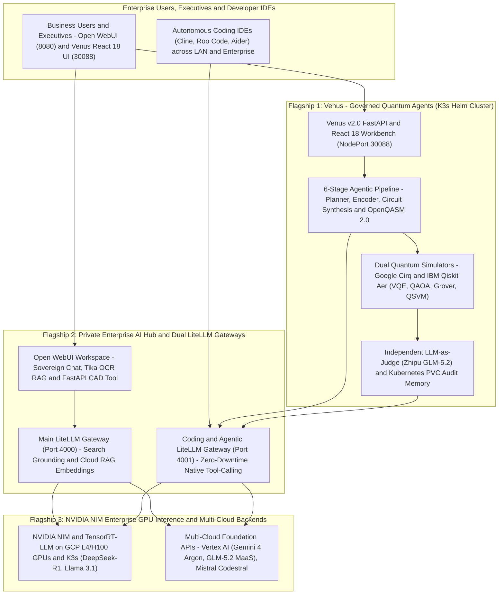

# AI Governance Lab 🏛️🤖⚛️

> **Principal Enterprise AI, Cloud & Quantum Platform Architecture — Production Code, Dual LiteLLM Gateways, NVIDIA GPU Serving & Governed Quantum Agents**  
> Founded & Maintained by **[Marian Ropota](https://www.linkedin.com/in/marian-rop)** (*Hands-On Enterprise AI/ML & Cloud Platform Architect*)

[-0A66C2?style=flat-square&logo=linkedin)](https://www.linkedin.com/in/marian-rop)

**AI Governance Lab** showcases **production-grade, hands-on Enterprise AI & Cloud Architecture** where every system blueprint is backed by **working full-stack code (Python, FastAPI, React 18, Asyncio, Pydantic v2)** and **turnkey infrastructure automation (Kubernetes/K3s, Helm, Terraform, Podman/Docker, Linux Systemd)**.

---

## 🎯 Executive Overview — The 3 Flagship 2026 Architecture Pillars

For **CTOs, Engineering Directors, HR, and Technical Recruiters**, this organization is structured around **three cutting-edge 2026 Principal Architect flagship systems** at the top, followed below by a proven track record of **10 foundational Multi-Cloud MLOps, Kubernetes, Vertex AI, and SAP S/4HANA** repositories:

| Flagship 2026 Pillar | Repository | Core 2026 Technologies | Principal Architect Scope |
| :--- | :--- | :--- | :--- |
| **1. Hybrid Quantum-AI & Independent LLM-as-Judge** | **[`governed-quantum-agents`](https://github.com/AI-Governance-Lab/governed-quantum-agents)** *(Venus v2.0)* | **Google Cirq & IBM Qiskit Aer**, VQE/QAOA/Grover/QSVM, OpenQASM 2.0, **React 18 Workbench**, **Venus Quantum AI Chat**, Cross-Model **GLM-5.2 Judge** & **Gemini 4 Argon**, **K3s Helm + PVC** | *Principal AI & Quantum Architect • AI Governance Lead* |
| **2. Sovereign Enterprise AI Hub & Dual LiteLLM Gateways** | **[`private-enterprise-ai-hub`](https://github.com/AI-Governance-Lab/private-enterprise-ai-hub)** | **Open WebUI (`:8080`)**, **Main LiteLLM (`:4000`)** + **Coding Agents Gateway (`litellm-agents :4001`)**, Vertex AI (**Gemini 4 Argon, 3.1 Pro, 3.8 Flash, GLM-5.2 1M MaaS**), **Mistral Codestral**, **Apache Tika OCR**, Custom **FastAPI CAD Microservice**, RAID-1 & `.env` Security | *Enterprise GenAI Platform Architect • Chief AI Architect* |
| **3. High-Performance GPU Inference & Hybrid Cloud IaC** | **[`nvidia-nim-enterprise-patterns`](https://github.com/AI-Governance-Lab/nvidia-nim-enterprise-patterns)** | **NVIDIA NIM, TensorRT-LLM, Triton Inference Server**, **DeepSeek-R1 & Llama 3.1** on **NVIDIA L4 24GB GPUs**, **Terraform Multi-Zone GCP MIGs**, `<25s` Warm TRT Cache & **K3s/Helm** | *Principal AI Infrastructure & GPU Platform Architect* |

---

## 🏛️ Unified 2026 Reference Architecture (How the 3 Flagships Connect)

### 🔐 Cross-Cutting Governance Layers

| Layer | Technologies | Architectural Purpose |
| :--- | :--- | :--- |
| **AI Evaluation & Onboarding** | LLM-as-a-Judge, Custom Eval Suites, Pydantic v2 | Pre-production quality gates, schema enforcement, hallucination & toxicity checks |
| **Data & Model Monitoring** | Evidently AI, Prometheus, Grafana | Continuous drift detection, data quality reports, post-market compliance evidence |
| **Experiment & Lineage Tracking** | MLflow 3.x, PostgreSQL, MinIO (S3) | Prompt/model versioning, reproducibility, approval stages, immutable audit trail |
| **Policy-as-Code & Security** | OPA / Gatekeeper, Kyverno, RBAC, NetworkPolicies | Kubernetes admission control, tenant isolation, least-privilege IAM |
| **AI FinOps & Gateway Control** | LiteLLM Proxy, Token/Cost Budgets, Fallback Routing | Multi-provider resilience, data residency routing (Cloud vs. Local GPU), cost governance |

---

## 🌟 Part 1: Flagship 2026 Enterprise Architectures (Core Focus)

### 1. ⚛️ [Venus: Governed Quantum Agents (`governed-quantum-agents`)](https://github.com/AI-Governance-Lab/governed-quantum-agents) — `🌐 Public • v2.0 Live on K3s`
**Enterprise Natural-Language-to-Quantum Discovery Workbench with Independent LLM-as-Judge Governance, React 18 UI, Dual Quantum SDKs & Kubernetes (K3s) Helm Deployment.**
- **Business-First React 18 Workbench & "Venus Quantum AI" Assistant:** Translates plain-English goals in clean energy ($\text{CO}_2$ capture MOFs), supply-chain logistics, cybersecurity anomaly hunting, and pharmaceutical safety screening into executable quantum circuits—complete with a *"What Does This Mean in Normal Words?"* guide, Qubit-to-Variable mapping, and a non-blocking 6-stage live execution tracker.
- **Real Quantum Engineering & Dual Compiler Backends:** Synthesizes and executes **VQE** (12-iteration COBYLA energy convergence in Hartrees within $<1.6\text{ mHa}$ chemical accuracy), **$p=2$ QAOA** (Ising/QUBO fleet optimization at $94.9\%$ approximation ratio), **Grover's Search** (dynamic phase oracle with optimal $k_{\text{opt}}$ iterations), and **QSVM** (`2nd-Order Pauli ZZFeatureMap` kernel) across **Google Cirq** and **IBM Qiskit Aer**, with **OpenQASM 2.0 export** and **Ideal vs. NISQ Depolarizing Noise (`p=0.03`)** simulation.
- **Cross-Model AI Governance Observatory:** Eliminates self-preference bias by routing Generator agents (`Planner`, `Encoder`, `Interpreter`) to **Google Gemini 4 Argon** while an independent **Zhipu GLM-5.2** Judge audits raw quantum telemetry against AI claims before persisting to a **Kubernetes `local-path` PersistentVolumeClaim (PVC)**.  
*Technologies: Google Cirq, IBM Qiskit Aer, OpenQASM 2.0, React 18, FastAPI, Python Asyncio, Pydantic v2, LiteLLM, Gemini 4 Argon, Zhipu GLM-5.2, Kubernetes (K3s), Helm*

---

### 2. 🏢 [Private Enterprise AI Hub (`private-enterprise-ai-hub`)](https://github.com/AI-Governance-Lab/private-enterprise-ai-hub) — `🌐 Public • Production Stack`
**Self-Hosted Sovereign Enterprise AI Platform, Dual LiteLLM Gateways (`:4000` & `:4001`), Zero-CPU Cloud RAG & Custom FastAPI CAD Microservice.**
- **70%–85% AI SaaS Cost Reduction & High-Availability Dual Gateways:** Replaces fragmented per-seat SaaS subscriptions with two isolated **LiteLLM Gateways**:
  - **Main Hub Gateway (`:4000`):** Powers **Open WebUI (`:8080`)** with Google Search grounding and cloud-offloaded RAG embeddings (`text-embedding-004`).
  - **Dedicated Coding Agents Gateway ([`litellm-agents :4001`](https://github.com/AI-Governance-Lab/private-enterprise-ai-hub/tree/main/litellm-agents)):** Serves **Cline, Roo Code, Aider, and Continue** across all LAN/Enterprise workstations with pure native function-calling and zero redeploy interruptions.
- **100% Local Data Sovereignty (GDPR Ready) & Domain Microservices:** Keeps all sensitive PDFs, financial workbooks, AutoCAD drawings (`.dwg`/`.dxf`), and SQLite databases on local **RAID-1 storage**, paired with **Apache Tika OCR (`:9998`)** and an air-gapped **FastAPI CAD-to-Excel Reconciliation Microservice (`cad-service`)**.
- **12-Factor `.env` Security & Dual Linux `systemd` Boot Resilience:** All ports, bind IPs, credentials, and API keys are isolated in `chmod 600` `.env` files, managed at boot by `private-ai.service` and `litellm-agents.service`.  
*Technologies: LiteLLM, Open WebUI, FastAPI, Google Vertex AI (Gemini 4 Argon, 3.1 Pro, 3.8 Flash, GLM-5.2 1M MaaS), Mistral Codestral 2508, NVIDIA NIM, Apache Tika OCR, Podman/Docker, Linux Systemd*

---

### 3. 🚀 [NVIDIA NIM Enterprise Patterns (`nvidia-nim-enterprise-patterns`)](https://github.com/AI-Governance-Lab/nvidia-nim-enterprise-patterns) — `🌐 Public • Verified on NVIDIA L4 24GB`
**Production Reference Architecture for High-Throughput, Low-Latency GPU Inference using NVIDIA NIM, TensorRT-LLM, Triton, Terraform & K3s/Helm.**
- **Predictable GPU FinOps (60%–70% Cloud Savings) & `<25s` Warm Recovery:** Automates multi-zone **GCP Regional Managed Instance Groups (MIG)** with Spot/Standard NVIDIA L4 GPUs via **Terraform**, using persistent host/PVC TensorRT-LLM engine caches to cut container startup from `235s` (cold compile) to **`< 25 seconds`**.
- **Two-Tier Hybrid GPU Topology:** Combines ephemeral GCP GPU benchmarking VMs (automated 2-stage kernel/driver 550/580 bootstrap, 32GB swap, `nvidia-ctk`) with declarative **Kubernetes (K3s) Helm** deployments (`16Gi /dev/shm` IPC, shared `100Gi+` PVC caches, and LiteLLM `drop_params: true` sidecar normalization for Chain-of-Thought `<think>` models like `deepseek-r1-distill-llama-8b`).  
*Technologies: NVIDIA NIM, TensorRT-LLM, Triton Inference Server, DeepSeek-R1, Meta Llama 3.1, K3s/Kubernetes, Helm, Terraform, GCP GPU MIGs, Python*

---

## 🏛️ Part 2: Foundational Enterprise Cloud, Kubernetes, MLOps & SAP Track Record (Earlier Experience)

Below are the **10 foundational production labs** demonstrating multi-year experience across **Multi-Cloud Terraform IaC (AWS EKS, Rancher, GCP, Azure)**, **SAP S/4HANA on IBM Red Hat OpenShift (ROKS) & PowerVS**, **Google Cloud Vertex AI (ADK, Kubeflow Pipelines, Cloud Run)**, and **Kubernetes MLOps / EU AI Act Observability (MLflow 3.x & Evidently AI)**:

| Repository | Architectural Domain | Key Technologies & Enterprise Scope |
| :--- | :--- | :--- |
| **[`k8s-ai-agent-multicloud-rag-iac`](https://github.com/AI-Governance-Lab/k8s-ai-agent-multicloud-rag-iac)** | **Multi-Cloud Agentic IaC & RAG** | Kubernetes AI agent combining **Qdrant RAG** with guarded **Terraform Runner Jobs** across **AWS EKS** (EFS RWX, EBS gp3, ALB) & **Rancher** (`Bedrock`, `Azure OpenAI`, `Ollama`). |
| **[`s4hana-ai-agent-openshift`](https://github.com/AI-Governance-Lab/s4hana-ai-agent-openshift)** | **SAP S/4HANA & IBM Cloud PowerVS** | Zero-touch **SAP S/4HANA** infrastructure provisioning agent on **IBM Red Hat OpenShift (ROKS)** powered by **IBM watsonx.ai**, **Qdrant**, and **Terraform** on **IBM PowerVS**. |
| **[`k8s-evidently-demo`](https://github.com/AI-Governance-Lab/k8s-evidently-demo)** | **EU AI Act & Drift Observability** | Continuous AI quality, data drift, and compliance evidence on Kubernetes using **Evidently AI**, **Prometheus**, and **Grafana** mapped to **EU AI Act, NIST RMF & ISO 42001**. |
| **[`k8s-mlfow-demo`](https://github.com/AI-Governance-Lab/k8s-mlfow-demo)** | **Cluster MLOps & LLMOps Lineage** | Production Helm deployment of **MLflow 3.x** on Kubernetes with **PostgreSQL** backend and **MinIO (S3)** artifact store for LLM prompt/model registry governance. |
| **[`k8s-mlflow-rancher-desktop`](https://github.com/AI-Governance-Lab/k8s-mlflow-rancher-desktop)** | **Local K3s MLOps Sandbox** | Single-command developer MLOps/LLMOps stack running **MLflow 3.x**, **PostgreSQL**, and **MinIO** on **Rancher Desktop (K3s)** via Helm. |
| **[`vertex-ai-agentbuilder-demo`](https://github.com/AI-Governance-Lab/vertex-ai-agentbuilder-demo)** | **Google Cloud ADK & Agent Engine** | Programmatic agent architectures using **Google Vertex AI Agent Builder**, **Reasoning Engine**, and **Agent Development Kit (ADK)** on Cloud Run. |
| **[`vertex-ai-pipeline-demo`](https://github.com/AI-Governance-Lab/vertex-ai-pipeline-demo)** | **Kubeflow v2 MLOps Pipelines** | Reproducible **Kubeflow Pipelines v2 (`kfp`)** compiled and executed on **Google Vertex AI Pipelines** with GCS artifact lineage. |
| **[`vertex-ai-cloudrun-demo`](https://github.com/AI-Governance-Lab/vertex-ai-cloudrun-demo)** | **Serverless Vertex AI Microservices** | Scale-to-zero Python microservices exposing **Vertex AI Embeddings (`text-embedding-004`)** and **Gemini** on **Google Cloud Run**. |
| **[`k8s-ai-agents-demo`](https://github.com/AI-Governance-Lab/k8s-ai-agents-demo)** | **Kubernetes Agent Reference Wiring** | Containerized AI agent microservices on Kubernetes integrating **Qdrant**, **FastAPI**, **IBM watsonx**, **MLflow**, and **Evidently AI**. |
| **[`k8s-ollama-fastapi-demo`](https://github.com/AI-Governance-Lab/k8s-ollama-fastapi-demo)** | **Air-Gapped Local LLM Serving** | Lightweight Kubernetes inference template combining **FastAPI** and **Ollama** for air-gapped local model serving. |

---

## 📦 Capabilities & Compliance Matrix

| Capability | `private-enterprise-ai-hub` | `nvidia-nim-enterprise-patterns` | `k8s-ai-agent-multicloud-rag-iac` | `s4hana-ai-agent-openshift` | `governed-quantum-agents` | `k8s-evidently` & `k8s-mlflow-*` | `vertex-ai-*` |
| :--- | :---: | :---: | :---: | :---: | :---: | :---: | :---: |
| **RAG & Document Intelligence** | ✅ (Tika OCR + Vertex) | ❌ | ✅ (Qdrant RWX) | ✅ (SAP Docs) | ✅ (Quantum Domain) | ❌ | ✅ |
| **Agentic Tool Execution** | ✅ (CAD Microservice) | ❌ | ✅ (Terraform Jobs) | ✅ (PowerVS IaC) | ✅ (Cirq / Qiskit) | ❌ | ✅ (ADK) |
| **LiteLLM / Multi-Model Routing** | ✅ (LiteLLM :4000) | ❌ | ✅ (Multi-Provider) | ❌ | ✅ (Core) | ❌ | ❌ |
| **LLM-as-a-Judge / Eval Gates** | 🔄 | ✅ (Test Suite) | 🔄 | 🔄 | ✅ (Core Judge) | ✅ (MLflow Eval) | ❌ |
| **Drift & Lineage Observability** | ❌ | ✅ (GPU Telemetry) | ✅ (Addon Ready) | 🔄 | ❌ | ✅ (Core) | ✅ (Pipelines) |
| **Multi-Cloud / Hybrid IaC** | ✅ (Podman/Systemd) | ✅ (GCP + K3s) | ✅ (AWS/Azure/GCP/IBM) | ✅ (ROKS + PowerVS) | ✅ (Docker/FastAPI) | ✅ (Helm/K8s) | ✅ (Cloud Run) |

### ⚖️ Regulatory & Framework Alignment

| Framework / Standard | Technical Controls Implemented Across Repositories |
| :--- | :--- |
| **EU AI Act & ISO/IEC 42001** | Pre-deployment LLM-as-a-Judge risk & hallucination evaluation (`governed-quantum-agents`), continuous post-market drift monitoring (`k8s-evidently-demo`), and versioned model/prompt lineage (`k8s-mlfow-demo`). |
| **NIST AI RMF 1.0** | *Govern, Map, Measure, Manage* functions operationalized via Policy-as-Code (OPA/Kyverno), structured Pydantic v2 I/O schemas, and automated evaluation pipelines. |
| **GDPR & Data Sovereignty** | Local RAID/PVC data residency (`private-enterprise-ai-hub`), namespace/tenant isolation, air-gapped or private GPU inference (`nvidia-nim-enterprise-patterns`, `vLLM`, `Ollama`), zero secrets in images. |
| **SOC2 & Supply Chain Security** | Declarative GitOps delivery (Argo CD / Helm), least-privilege Service Accounts, container hardening, SBOM/Trivy scanning, and immutable execution logs. |

---

## 🏛️ Architectural Principles

- **🎯 Blueprint-to-Code Execution:** Every reference architecture is paired with executable Terraform modules, Helm charts, Docker/Podman definitions, and automated validation scripts.
- **🤖 Unified AI Gateway & FinOps Control:** Centralized LiteLLM proxy plane managing multi-provider authentication, fallback meshes, and token/cost budgets across cloud and local GPU models.
- **🛡️ Governance by Design:** Evaluation gates, schema validation, drift detection, and audit logging are embedded into the runtime architecture—not bolted on after deployment.
- **🌐 Hybrid & Multi-Cloud Portability:** Workload mobility across hyperscalers (GCP, IBM Cloud, AWS, Azure) and on-premises/edge infrastructure (OpenShift, Rancher, K3s, OpenStack).
- **⚡ Performance & Resource Efficiency:** Hardware-profiled GPU inference (TensorRT-LLM / NIM / vLLM) combined with cloud-offloaded embeddings and scale-to-zero serverless patterns.

---

## 🌍 Industry Reference Blueprints

- **📡 Telecommunications & Cloud Infrastructure:** Enterprise AI evaluation & onboarding frameworks, multi-cluster Kubernetes/OpenStack orchestration, and automated platform resilience.
- **🏦 Financial Services & Insurance:** Governed RAG and agentic workflows with full audit lineage (MLflow + Evidently), data platform modernization patterns, and quantum-assisted portfolio/fraud analysis.
- **🏭 Enterprise ERP & Manufacturing (SAP S/4HANA):** Zero-touch SAP infrastructure provisioning on IBM Cloud PowerVS and Red Hat OpenShift via guarded AI agents and Terraform/Ansible automation.
- **🛒 Retail & Document-Heavy Operations:** Cloud-native analytics pipelines (BigQuery, Dataflow, Vertex AI), OCR document intelligence (Apache Tika), and automated CAD/tabular reconciliation microservices.
- **🛡️ Cybersecurity & Life Sciences:** Quantum Grover log search simulations, HIPAA/GDPR-isolated RAG deployments, and zero-trust container supply chains.

---

## 🧰 Technology Stack

- **Cloud & Virtualization:** Google Cloud (Vertex AI, BigQuery, Dataflow, Pub/Sub, Cloud Run, GKE), IBM Cloud (watsonx.ai, ROKS/OpenShift, PowerVS), AWS (EKS, Bedrock, EFS/EBS/ALB), Azure, OpenStack, VMware/KVM
- **Container & GitOps Orchestration:** Kubernetes, Red Hat OpenShift, Rancher, K3s, Helm, Argo CD, Docker, Podman, Systemd
- **Infrastructure as Code:** Terraform, Ansible, Cloud Build
- **AI Inference & Gateways:** NVIDIA NIM, TensorRT-LLM, Triton, NeMo, vLLM, Ollama, LiteLLM Proxy, OpenRouter
- **Foundation Models:** Google Gemini, IBM watsonx, OpenAI, Anthropic Claude, Mistral (Codestral / Ministral), DeepSeek, NVIDIA Nemotron, Zhipu GLM
- **Agentic Frameworks & Developer Tooling:** LangGraph, LangChain, Google ADK, Python Asyncio + Pydantic v2, Model Context Protocol (MCP), Open WebUI
- **Data, RAG & MLOps Governance:** Qdrant, Apache Tika, MLflow 3.x, Evidently AI, OPA / Kyverno, PostgreSQL, MinIO (S3), Prometheus, Grafana
- **Quantum Computing:** Google Cirq, IBM Qiskit

---

## 📄 License & Contributions

All repositories in **AI Governance Lab** are released under permissive open-source licenses (predominantly **Apache License 2.0**; see individual repository `LICENSE` files). Issues, architectural discussions, and pull requests are welcome.

---

## 👨‍💻 Founder & Lead Maintainer

**Marian Ropota** — *Hands-On AI/ML & Cloud Platform Architect | Hybrid Cloud Infrastructure, LLMOps & Agentic Engineering*  
🔗 **[LinkedIn Profile](https://www.linkedin.com/in/marian-rop)** • 🏅 **[Credly Verified Certifications](https://www.credly.com/users/marian-ropota/badges/credly)** • 🐙 **[AI Governance Lab](https://github.com/AI-Governance-Lab)**